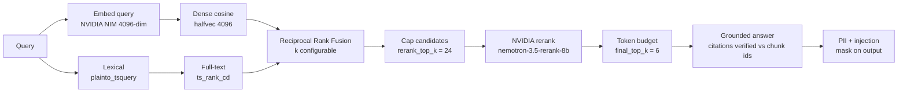

<div align="center">

# 🗺️ Atlas

### Strictly-typed, DI-first enterprise RAG platform
**Groq · OpenAI · Anthropic · NVIDIA · pgVector · FastAPI**

[](https://www.python.org/)
[](https://fastapi.tiangolo.com/)
[](https://www.postgresql.org/)
[](https://github.com/pgvector/pgvector)
[](https://redis.io/)
[](https://docs.docker.com/compose/)
[](https://mypy.readthedocs.io/)
[](https://docs.astral.sh/ruff/)
[](#-testing--quality-gates)
[](#-license)

> **Named after the map of the world** — Atlas is a tenant-isolated, self-hosted retrieval index over your own corpus.
> No SaaS black box. No vendor lock-in. Every component crosses a `Protocol` port.

[Quickstart](#-quickstart) · [Architecture](#-architecture) · [API](#-api-reference) · [Configuration](#-configuration) · [Evaluation](#-measured-retrieval-quality) · [Roadmap](#-roadmap) · [Specs](#-specs--adrs)

</div>

---

## 🎯 Why Atlas

Most RAG demos collapse in production for the same five reasons. Atlas is built around closing them:

| Production gap | How Atlas closes it |
|---|---|
| Dense-only retrieval misses exact symbols | **Hybrid search** — pgVector cosine + Postgres `tsvector`/`ts_rank_cd`, fused with Reciprocal Rank Fusion, then NVIDIA rerank |
| Chunking is an afterthought | **Two chunkers behind `ChunkerPort`** — `RecursiveChunker` (default, zero extra cost) and `SemanticChunker` (embedding-similarity boundaries) |
| "Late chunking" oversold by vendors | **Honest about limits** — NIM returns pooled vectors only, so Atlas uses hierarchical recursive chunking + late *fusion* at retrieval. A token-level provider slots in as a new `EmbedderPort` adapter |
| Single-tenant assumptions | **Tenant isolation on every SQL predicate** + per-tenant rate limits + per-tenant object-storage keys |
| RAG without safety | **Two-direction security** — PII + prompt-injection checks on ingest *and* on model output; citations verified against retrieved chunk ids before they reach the client |

Also included because enterprise RAG needs them: typed error envelopes, request ids, security headers, OpenTelemetry traces, structured logs, readiness probes, queue-based async ingestion, chaos-based fault injection for resilience tests, and a separate ingestion worker.

---

## 🏛️ Architecture

```mermaid
flowchart TB
    subgraph Client["Client"]
        U[User / App]
    end

    subgraph API["atlas_api — FastAPI (stateless)"]
        MW[Middlewares<br/>request id · security headers · rate limit]
        R[Routes<br/>/v1/chat · /v1/documents · /healthz · /readyz]
        DEPS[Deps → app.state.container]
    end

    subgraph Worker["atlas_worker — arq / Redis"]
        T[Ingestion tasks<br/>processing → indexed | failed]
    end

    subgraph Core["atlas_core — domain, ports, config, security, DI"]
        P[Protocol ports<br/>ChatPort · EmbedderPort · RerankerPort · ...]
        CFG[Pydantic settings<br/>nested __ groups]
        SEC[PII · injection guard · chaos]
        OBS[structlog · OpenTelemetry]
    end

    subgraph Adapters["Adapters (depend on ports, never the reverse)"]
        LLM[atlas_llm<br/>LangChain: Groq · OpenAI · Anthropic · NVIDIA]
        VEC[atlas_vector<br/>SQLAlchemy async · pgVector]
        STO[atlas_storage<br/>obstore: S3/RustFS/GCS/local]
        ING[atlas_ingest<br/>loaders · chunkers · pipeline]
        RET[atlas_retrieval<br/>hybrid retriever · grounded AnswerService]
    end

    subgraph Infra["Infrastructure"]
        PG[(PostgreSQL 17<br/>pgVector · GIN full-text)]
        RD[(Redis 7<br/>arq queue · rate limiter)]
        OS[(Object store<br/>RustFS / S3 / GCS)]
    end

    U --> MW --> R --> DEPS
    DEPS --> RET
    RET --> VEC & LLM
    R -->|enqueue| RD
    RD --> T
    T --> ING --> STO & VEC & LLM
    VEC --> PG
    STO --> OS
    Core -.wires.-> Adapters
```

### Module map

| Module | Responsibility | Depends on |
|---|---|---|
| `atlas_core` | Domain models, `Protocol` ports, config, security, observability, Dishka providers | — (the kernel) |
| `atlas_llm` | LangChain adapters: chat (Groq/OpenAI/Anthropic/NVIDIA), NVIDIA embeddings + rerank | `atlas_core` |
| `atlas_vector` | SQLAlchemy async schema, pgVector repositories, Dishka provider | `atlas_core` |
| `atlas_storage` | `ContentStorePort` — S3/RustFS/MinIO, GCS, local directory | `atlas_core` |
| `atlas_ingest` | Loaders (txt/md/html/pdf), chunkers, ingest pipeline | `atlas_core`, `atlas_llm`, `atlas_vector`, `atlas_storage` |
| `atlas_retrieval` | Hybrid retriever (RRF/rerank), grounded `AnswerService` (citations + trace) | `atlas_core`, `atlas_llm`, `atlas_vector` |
| `atlas_api` | FastAPI app, auth/rate-limit deps, middlewares, routes, schemas | all of the above |
| `atlas_worker` | arq worker + ingestion tasks | all of the above |

**Dependencies point inward.** `atlas_core` knows nothing about FastAPI, LangChain, or Postgres. Every cross-boundary call goes through a `Protocol` port, registered in Dishka **by port type** (protocols, not concrete classes) — so swapping a provider, model, or storage backend is additive.

---

## 🧠 Retrieval pipeline



**Key measured facts (not guesses):**

- 📏 **Embeddings are 4096-dim**, stored as `halfvec(4096)`. pgVector caps ANN indexes at 4,000 dims for `halfvec`, so Atlas runs an **exact cosine scan** — no HNSW/IVFFlat index. `halfvec` halves storage and exact-scan I/O vs `vector(4096)` with no re-embedding.
- 🔢 **Rerank depth = 24** is the smallest measured depth that loses nothing: 50 candidates produced a *bit-identical* ranking at ~2× the p50 latency.
- 🔀 **Reranking, not fusion, is the quality lever.** On the Atlas corpus, RRF alone *lowers* nDCG (66.7% vs 71.2%) while raising recall; the reranker then lifts nDCG to **85.7%** (+14.4 pp, 95% CI +7.2 … +21.9).
- 🧾 **Lexical branch is retained** because it is the only recall source without a reranker and the only defence against exact-identifier queries (error codes, SKUs, config keys). It costs ~1.7 pp nDCG on generated questions but gains ~5 pp on exact identifiers.

---

## 📊 Measured retrieval quality

Reproducible via `make eval` / `make eval-docs` / `make eval-identifiers`. Ground truth is keyed by `(document checksum, chunk seq)`, so query sets survive re-ingestion and can be committed.

### Atlas corpus — 112 chunks / 40 judged queries

| Arm | recall@10 | MRR | nDCG@10 | hit@1 | p50 |
|---|---:|---:|---:|---:|---:|
| `full4096` (dense only) | 92.5% | 0.642 | 71.2% | 45.0% | 2.2 ms |
| `hybrid` (RRF) | 97.5% | 0.569 | 66.7% | 35.0% | 48.0 ms |
| `hybrid-rerank@24` | **100.0%** | **0.808** | **85.7%** | **67.5%** | 1012.7 ms |
| `hybrid-rerank@12` | 97.5% | 0.802 | 84.6% | 67.5% | 638.1 ms |

### Public docs corpus — 8,990 chunks / 120 judged queries (FastAPI, Django, Pydantic, pgVector)

| Arm | recall@10 | MRR | nDCG@10 | hit@1 | p50 |
|---|---:|---:|---:|---:|---:|
| `full4096` (8B) | 80.8% | 0.591 | 64.4% | 47.5% | 19.2 ms |
| `trunc2048` | 80.0% | 0.580 | 63.4% | 45.0% | 51.4 ms |
| `reembed:1b@2048` | 80.8% | 0.545 | 60.9% | 40.0% | 12.7 ms |
| `hybrid-rerank@24` | 80.0% | 0.684 | 71.3% | 60.0% | 1164.2 ms |
| `dense-rerank@24` | 81.7% | 0.693 | 72.4% | 60.0% | 1012.4 ms |

**Width decision:** truncating the 8B embedder to 2048 dims costs nothing measurable (Δ nDCG −1.0 pp, 95% CI −2.8 … +0.6) but gains nothing; the 1B model is measurably worse (−3.5 pp, CI −6.9 … −0.2). A tie does not justify a migration + re-ingest, so 4096 + `halfvec` stands. See [ADR 0003](specs/adr/0003-embedding-width-and-ann-indexing.md).

**Exact-identifier queries** (symbols appearing in ≤3 chunks, used alone as the query) are the one case dense retrieval fails on; the lexical branch gains ~5 pp there once reranking is in place. See [ADR 0004](specs/adr/0004-retrieval-fusion-and-rerank-policy.md).

---

## 🚀 Quickstart

```bash
# 1. Configure
cp .env.example .env          # then set GROQ__API_KEY and NVIDIA__API_KEY
                              # (or pick another CHAT__PROVIDER)

# 2. Install + infra
uv sync
docker compose up -d postgres redis rustfs
make storage-init              # creates the object-storage bucket (idempotent)

# 3. Migrate + run
uv run alembic upgrade head
uv run atlas-api              # http://localhost:8000/docs
uv run arq atlas_worker.main.WorkerSettings   # separate terminal
```

> `.env` in this repo predates the settings schema. If it still uses `GROQ_API_KEY` / `NVIDIA_API_KEY`, rename them to `GROQ__API_KEY` / `NVIDIA__API_KEY` (nested groups use a double underscore).

### Ingest and ask

```bash
# Ingest
curl -s localhost:8000/v1/documents \
  -H "X-API-Key: dev-key" -H "Content-Type: application/json" \
  -d '{"source_uri":"handbook.md","mime":"text/markdown","content":"# Refunds\nRefunds are processed in 5 business days."}'

# Ask
curl -s localhost:8000/v1/chat \
  -H "X-API-Key: dev-key" -H "Content-Type: application/json" \
  -d '{"query":"How long do refunds take?"}'
```

Streaming: `{"query": "...", "stream": true}` → SSE with `delta` events and one `final` event carrying citations + trace.

---

## 🔌 API reference

| Method | Path | Auth | Purpose |
|---|---|---|---|
| `GET` | `/healthz` | none | liveness |
| `GET` | `/readyz` | none | DB + Redis readiness |
| `POST` | `/v1/chat` | API key | grounded answer / SSE stream |
| `POST` | `/v1/documents` | API key | register document + enqueue ingest (202) |
| `GET` | `/v1/documents` | API key | latest documents for the tenant |
| `GET` | `/v1/documents/{id}` | API key | document head status (derived) |
| `GET` | `/v1/documents/{id}/versions` | API key | immutable version lineage, newest first |
| `DELETE` | `/v1/documents/{id}` | API key | delete document, versions, blobs refs and chunks (FK cascade) |

**Auth:** `X-API-Key: <key>` or `Authorization: Bearer <key>`. Keys map to tenants via `SECURITY__API_KEYS="key=tenant,key2=tenant2"`. Rate limit is a per-key sliding window (`SECURITY__RATE_LIMIT_RPM`).

**Errors** are uniform: `{"error": {"code", "message", "details"}}`; `429` adds `Retry-After`.

---

## ⚙️ Configuration

All settings are typed in `atlas_core/config.py`; nested env groups use `__`:

| Group | Notable fields |
|---|---|
| `CHAT__` | `PROVIDER` (`groq\|openai\|anthropic\|nvidia`, default `groq`), `TEMPERATURE`, `MAX_TOKENS`, `REQUEST_TIMEOUT`, `MAX_RETRIES` |
| `GROQ__` | `API_KEY`, `MODEL` (default `llama-3.3-70b-versatile`), optional `BASE_URL` (proxy only) |
| `OPENAI__` | `API_KEY`, `MODEL` (`gpt-4o-mini`), `BASE_URL` — set to any OpenAI-compatible `/v1` root |
| `ANTHROPIC__` | `API_KEY`, `MODEL` (`claude-haiku-4-5-20251001`), `BASE_URL` |
| `NVIDIA__` | `API_KEY`, `CHAT_MODEL` (`meta/llama-3.1-8b-instruct`), `EMBEDDING_MODEL` (`nvidia/nemotron-3.5-embed-8b`, 4096 dims), `EMBEDDING_DIMENSIONS` (4096), `RERANK_MODEL` (`nvidia/nemotron-3.5-rerank-8b`), `RERANK_BASE_URL` (self-hosted NIM/vLLM only) |
| `POSTGRES__` | `URL` (asyncpg), pool + statement timeout |
| `REDIS__` | queue + rate limiter |
| `CHUNKING__` | `CHUNK_SIZE_TOKENS`, `OVERLAP_TOKENS`, `ENABLE_SEMANTIC_CHUNKS` |
| `RETRIEVAL__` | `SEMANTIC_TOP_K`, `LEXICAL_TOP_K`, `RERANK_TOP_K` (candidates to reranker, default 24), `FINAL_TOP_K`, `ENABLE_RERANK`, `RRF_K` |
| `SECURITY__` | `API_KEYS`, `PII_POLICY` (`off\|mask`), `RATE_LIMIT_RPM`, `DISABLE_INJECTION_GUARD` |
| `OBSERVABILITY__` | `LOG_LEVEL`, `LOG_JSON`, `OTLP_ENDPOINT` (empty = tracing off) |
| `CHAOS__` | `ENABLED`, `FAILURE_RATE`, `SLEEP_SECONDS` — never enable in prod |
| `STORAGE__` | `BACKEND` (`local\|s3\|gcs`), `BUCKET`, `ENDPOINT`, credentials, `LOCAL_ROOT` |

### 🧩 Ports (hexagonal boundary)

| Port | Purpose |
|---|---|
| `ChatPort` | LLM chat + streaming (Groq/OpenAI/Anthropic/NVIDIA) |
| `EmbedderPort` | Vector embeddings (NVIDIA NIM) |
| `RerankerPort` | Cross-encoder reranking |
| `ChunkerPort` | Recursive / semantic chunking |
| `DocumentRepositoryPort` | Document + chunk persistence |
| `VectorRepositoryPort` | pgVector + full-text search |
| `ContentStorePort` | Object storage (S3/RustFS/GCS/local) |
| `QueuePort` | Async ingestion (arq/Redis) |
| `PiiDetectorPort` | PII detection + masking |
| `InjectionGuardPort` | Prompt-injection detection |

### 🗄️ Embedding width & indexing (ADR 0003)

Embeddings are 4096-dimensional, stored as `halfvec(4096)`. pgVector caps ANN indexes at 4,000 dimensions for `halfvec`, so Atlas does **not** create an HNSW/IVFFlat index: dense retrieval runs an exact cosine scan, while lexical retrieval stays GIN-indexed. `halfvec` halves storage and exact-scan I/O versus `vector(4096)` with no re-embedding. That is exact but scales linearly with each tenant's chunk count (~140 ms p50 at 50k chunks, ~355 ms at 200k). Trigger conditions to revisit ANN: a tenant above ~500k–1M chunks, retrieval p95 above ~1 s, or a UI needing sub-10 ms retrieval.

The 4096-native `nemotron-3.5-embed-8b` is the only 4096-dim model on the NVIDIA key used here and has variable cold-start latency (77–120 s+); the adapter allows 180 s and retries transient failures once. Keep it warm (scheduled ping) or self-host the NIM.

### 🔄 Chat providers

Every provider implements the same `ChatPort`, so switching is configuration only:

```bash
CHAT__PROVIDER=openai
OPENAI__BASE_URL=http://localhost:11434/v1   # any OpenAI-compatible endpoint
OPENAI__MODEL=qwen2.5
OPENAI__API_KEY=ollama
```

`ChatSettings` (`CHAT__`) holds sampling and retry policy shared by all adapters. Provider modules only construct the LangChain model; message mapping, streaming, chaos hooks and error normalisation live in `atlas_llm/langchain_chat.py`. Embeddings and reranking stay on NVIDIA NIM, so retrieval does not change with the chat provider.

### 💾 Object storage & document versioning (ADR 0005, e03 in progress)

Document bytes live behind `ContentStorePort` — S3-compatible (AWS S3, **RustFS**, MinIO), GCS, or a local directory. Keys are tenant-scoped and content-addressed: `{tenant}/{sha256[:2]}/{sha256}`. Dedupe is **per tenant, never cross-tenant** (a shared blob would let a tenant infer another tenant's content by comparing checksums).

- `local` is the default so a fresh clone needs no infrastructure; the compose stack sets `STORAGE__BACKEND=s3` against RustFS.
- Presigning is a capability: `local` cannot sign and raises `StorageCapabilityError`.
- Migration `0004` added `blobs`, `document_versions`, `documents.head_version_id`, and `chunks.document_version_id`. Migration `0005` retired `document_contents` and `documents.checksum`/`mime`/`status`/`error`; document status is now derived from the newest version.
- `documents.head_version_id` flips only after a version reaches `indexed`, so a failed ingest stays in the lineage and never becomes searchable. Re-uploading the head's bytes returns `created: false`; editing appends a version. Status: **e03 building** (upload transport, history/revert, and the UI are e03s04–e03s05).

---

## 🛡️ Security

- **PII:** Presidio-based detection on ingest; policies `off | mask | block | anonymize`. Two-direction: ingest masking + answer masking.
- **Prompt injection:** detection on **both** source content and model output (anchored to start of line; requires a blank line before a system-role prefix).
- **Tenant isolation:** row-level, `WHERE tenant_id = ?` on every query; API keys map to tenants.
- **Rate limiting:** per-key sliding window (Redis-backed), `429` + `Retry-After`.
- **Chaos:** fault injection (`CHAOS__ENABLED`) for resilience tests — never enable in prod.
- **Headers / request ids / typed error envelopes** on every response.

Full plan: [SECURITY_PLAN_LATEST.md](specs/tech-architecture/SECURITY_PLAN_LATEST.md).

---

## 📈 Observability

- Structured logs via `structlog` (`OBSERVABILITY__LOG_JSON`).
- OpenTelemetry traces (OTLP export opt-in via `OBSERVABILITY__OTLP_ENDPOINT`).
- Readiness probe `/readyz` checks DB + Redis.
- Request ids propagated through middlewares.

---

## 🐳 Deployment (serverless-friendly)

Two deployables, one image recipe each:

- **API** (`Dockerfile.api`): stateless FastAPI/uvicorn → Cloud Run / Fly Machines / ECS Fargate. Scale on concurrency; `/healthz` liveness, `/readyz` readiness. Session state lives only in Postgres/Redis.
- **Ingestion worker** (`Dockerfile.worker`): arq consumer → Cloud Run Jobs + scheduler, Fly process group, or small always-on worker. Horizontally scalable; jobs retried (`max_tries=3`); pipeline sets `processing → indexed|failed`, so re-running an unfinished document is safe. For bursty corpora, put ingestion behind your own queue producer — `QueuePort` isolates the arq choice.
- **Migrations:** run `alembic upgrade head` as a release/deploy step (or one-shot job), never at app startup.

Both containers run `uv sync --frozen --no-dev` and use the same lockfile. OTLP export opt-in.

### Production checklist

- Rotate API keys; load from a secret manager (`SECURITY__API_KEYS`).
- Set `PII_POLICY=mask` for regulated tenants, and decide your object-storage retention deliberately: migrations `0004`/`0005` moved raw document bytes out of Postgres into `ContentStorePort`, so the bucket — not the database — is where the original text lives.
- Keep `CHAOS__ENABLED=false` and `OBSERVABILITY__LOG_JSON=true` in prod.
- Add per-tenant budgets/alerts on whichever provider chat traffic uses; adapters retry transient errors through the LangChain client's `max_retries` (`CHAT__MAX_RETRIES`).
- Rerank: leave `NVIDIA__RERANK_BASE_URL` empty for the hosted `nemotron-3.5-rerank-8b` endpoint, or set it to a self-hosted NIM/vLLM deployment root (e.g. `http://localhost:8000/v1`); the LangChain client derives `/ranking` from that root. Validate the model name against your account/region before rollout.

---

## 🧪 Testing & quality gates

```bash
make sync       # uv sync
make lint       # ruff
make typecheck  # mypy --strict (+ basedpyright)
make test       # pytest
make preflight  # all four (ruff + mypy + basedpyright + pytest)
make migrate    # alembic upgrade head
```

Tests are **service-free**: the pipeline test uses in-memory repositories, and the API tests never touch Postgres/Redis. Type checking is strict (mypy + basedpyright) with `py.typed` markers on every package.

CI runs on every push/PR: `ruff check` → `mypy` → `basedpyright` → `pytest` (see [.github/workflows/ci.yml](.github/workflows/ci.yml)).

---

## 🗺️ Roadmap

Status per [release-plan.yaml](specs/release-plan.yaml):

| Epic | Title | Status |
|---|---|---|
| e01 | Live-run hardening — 4096-dim embeddings and hosted reranking | ✅ done |
| e02 | Retrieval quality — measured rerank depth, tenant-scale width, real type gate | 📋 planned |
| e03 | Object storage + immutable document versions | 🏗️ building |

Deliberately out of scope (ports make each additive): Ragas/TruLens on top of the built-in eval harness, hierarchical summary levels (RAPTOR), per-request model budgets, JWT/OIDC auth, MMR diversity, true late chunking once a token-level embedding provider is added, resumable uploads (tus/S3 multipart).

---

## 📚 Specs & ADRs

All planning lives in [`specs/`](specs/) — Atlas treats specs as first-class artifacts.

### Architecture Decision Records

| ADR | Decision |
|---|---|
| [0001](specs/adr/0001-retrieval-and-di.md) | Retrieval, chunking, and DI — hybrid RRF, ports by protocol, arq queue, two-direction security |
| [0002](specs/adr/0002-langchain-llm-adapters.md) | LangChain LLM adapters — one `ChatPort`, provider modules only construct the model |
| [0003](specs/adr/0003-embedding-width-and-ann-indexing.md) | 4096 dims + `halfvec` + exact scan; no HNSW; rerank depth 24 |
| [0004](specs/adr/0004-retrieval-fusion-and-rerank-policy.md) | Fusion + rerank policy; lexical branch retained |
| [0005](specs/adr/0005-object-storage-and-content-addressing.md) | Object storage behind `ContentStorePort`, content-addressed, per-tenant dedupe |

### Other specs

- [Product vision](specs/product/VISION_LATEST.yaml) · [Scope](specs/product/SCOPE_LATEST.yaml) · [Glossary](specs/product/GLOSSARY_LATEST.yaml)
- [Tech stack](specs/tech-architecture/tech-stack.md) · [Security plan](specs/tech-architecture/SECURITY_PLAN_LATEST.md) · [Test plan](specs/tech-architecture/TEST_PLAN_LATEST.md)
- [Bug registry](specs/bugs/registry.yaml) — 8 bugs, all fixed
- [Conventions](CONVENTIONS.md) · [Evaluation harness guide](specs/eval/README.md)

### Measured evidence

- [BENCH-indexing.md](specs/verifications/BENCH-indexing.md) · [BENCH-rerank-depth.md](specs/verifications/BENCH-rerank-depth.md)
- [EVAL-retrieval.md](specs/verifications/EVAL-retrieval.md) · [EVAL-retrieval-hybrid.md](specs/verifications/EVAL-retrieval-hybrid.md)
- [EVAL-retrieval-public-docs.md](specs/verifications/EVAL-retrieval-public-docs.md) · [EVAL-retrieval-public-docs-identifiers.md](specs/verifications/EVAL-retrieval-public-docs-identifiers.md)

---

## 🤝 Contributing

1. Read [CONVENTIONS.md](CONVENTIONS.md) and the relevant spec before changing code.
2. Branch from `master` (`kickoff-branch`), commit with Conventional Commits (`feat(scope): …`).
3. Run `make preflight` before pushing; CI must be green.
4. Discovered defects: fix or log in `specs/bugs/` — never dismiss a red gate.

CI runs on GitHub Actions (`.github/workflows/`) against `origin`; `make preflight` is the same gate locally, so run it before pushing rather than discovering it in CI. Semantic-release tags from `master` once a release-worthy commit lands.

---

## 📄 License

No license file is present in the repository yet. Contact the maintainer before using Atlas in production or redistributing it.

---

<div align="center">

Built with ❤️ by [Akshay B](mailto:akshay2642005@gmail.com) · Atlas v0.1.0

</div>
